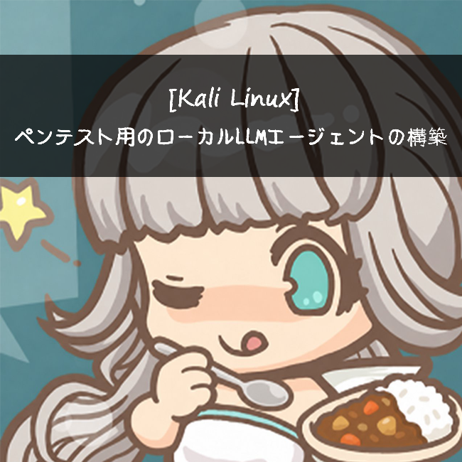

<meta name="viewport" content="width=device-width, initial-scale=1">

# [Kali Linux] ペンテスト用ローカルLLMエージェントの構築

<p style="text-align:center">
<br></p>
<br>

### この記事は大幅に修正されました（？）

# Building A Local  LLM Agent For Pentesting

今回は、ペネトレーションテストの演習や<br><br>
バグバウンティプログラムでのバグハンティングにかかる時間をできるだけ節約するため、<br>
今も注目されている（？）ローカルLLMを構築します。<br>

可能な限りGPUのない低スペック（CPUのみ）の環境を想定しています。<br>
設定は以下のとおりです。<br>

## 1. パッケージ一覧の更新とDockerのインストール

```bash 
sudo apt update && sudo apt install -y docker.io
```

以下のような出力が表示されれば、インストールは成功です。

<details>
<summary>👉 Click to expand </summary>

``` bash
┌──(root💀kali)-[/home/kali/H■■n■/■■■ls]
└─# sudo apt update && sudo apt install -y docker.io
Get:1 http://mirror.keiminem.com/kali kali-rolling InRelease [34.0 kB]
Get:2 http://mirror.keiminem.com/kali kali-rolling/main amd64 Packages [21.9 MB]
Get:3 http://mirror.keiminem.com/kali kali-rolling/main amd64 Contents (deb) [53.9 MB]
Get:4 http://mirror.keiminem.com/kali kali-rolling/contrib amd64 Packages [104 kB]
Get:5 http://mirror.keiminem.com/kali kali-rolling/contrib amd64 Contents (deb) [171 kB]
Get:6 http://mirror.keiminem.com/kali kali-rolling/non-free amd64 Packages [170 kB]
Get:7 http://mirror.keiminem.com/kali kali-rolling/non-free amd64 Contents (deb) [878 kB]
Get:8 http://mirror.keiminem.com/kali kali-rolling/non-free-firmware amd64 Packages [17.3 kB]
Get:9 http://mirror.keiminem.com/kali kali-rolling/non-free-firmware amd64 Contents (deb) [44.4 kB]
Fetched 77.2 MB in 22s (3,567 kB/s)                                             
178 packages can be upgraded. Run 'apt list --upgradable' to see them.
The following packages were automatically installed and are no longer required:
  chromium-sandbox            libfmt10        libopenjph0.28
  gcc-15-base                 libfyaml0       libsimdutf33
  gnome-accessibility-themes  libgcc-15-dev   libstdc++-15-dev
  gnome-themes-extra          libgumbo3       libstemmer0d
  libaccountsservice0         libhdf4-0       libunibreak7
  libappstream5               libmupdf27.0    libxmlb2
  libavfilter11               libntfs-3g90    python3-unicodedata2
  libflashrom1                libobjc-15-dev
Use 'sudo apt autoremove' to remove them.

Installing:
  docker.io
                                                                                 
Installing dependencies:
  containerd     libintl-xs-perl            python3-protobuf
  criu           libmodule-find-perl        python3-pycriu                       
  docker-buildx  libproc-processtable-perl  runc                                 
  docker-cli     libsort-naturally-perl     tini-static                          
  libcompel1     libterm-readkey-perl                                            
  libintl-perl   needrestart                                                     
                                                                                 
Suggested packages:
  containernetworking-plugins  debootstrap  xfsprogs
  docker-doc                   rinse        zfs-fuse
  btrfs-progs                  rootlesskit  | zfsutils-linux

Summary:
  Upgrading: 0, Installing: 17, Removing: 0, Not Upgrading: 178
  Download size: 80.1 MB
  Space needed: 338 MB / 60.1 GB available

Get:1 http://http.kali.org/kali kali-rolling/main amd64 runc amd64 1.3.6+ds1-1 [6,708 kB]
Get:6 http://http.kali.org/kali kali-rolling/main amd64 docker-cli amd64 28.5.2+dfsg4-5 [8,260 kB]
Get:7 http://http.kali.org/kali kali-rolling/main amd64 tini-static amd64 0.19.0-6+b3 [280 kB]
...<omission>...
Get:13 http://mirror.krfoss.org/kali kali-rolling/main amd64 libsort-naturally-perl all 1.03-4 [13.1 kB]
Get:16 http://mirror.zzunipark.com/kali kali-rolling/main amd64 python3-protobuf amd64 3.21.12-17 [156 kB]
Get:4 https://mirror5.krfoss.org/kali kali-rolling/main amd64 criu amd64 4.2.1-1 [557 kB]
Get:10 http://http.kali.org/kali kali-rolling/main amd64 libintl-xs-perl amd64 1.37-1+b1 [15.2 kB]
Fetched 80.1 MB in 14s (5,777 kB/s)                                             
Preconfiguring packages ...
Selecting previously unselected package runc.
(Reading database… 486585 files and directories currently installed.)
Preparing to unpack …/00-runc_1.3.6+ds1-1_amd64.deb…
Unpacking runc (1.3.6+ds1-1)…
Selecting previously unselected package containerd.
Preparing to unpack …/01-containerd_2.1.9+ds1-5_amd64.deb…
...<omission>...
Setting up python3-pycriu (4.2.1-1)…
Setting up docker.io (28.5.2+dfsg4-5)…
Creating group 'docker' with GID 963.
update-rc.d: We have no instructions for the docker init script.
update-rc.d: It looks like a non-network service, we enable it.
Created symlink '/etc/systemd/system/multi-user.target.wants/docker.service' → '/usr/lib/systemd/system/docker.service'.
Created symlink '/etc/systemd/system/sockets.target.wants/docker.socket' → '/usr/lib/systemd/system/docker.socket'.
Setting up libintl-xs-perl (1.37-1+b1)…
Processing triggers for libc-bin (2.43-7)…
Processing triggers for man-db (2.13.1-1)…
Processing triggers for kali-menu (2026.3.4)…
```
</details>
<!-- 折りたたみセクション終了 -->

## 2. Dockerサービスの起動と起動時の自動実行設定

```bash 
sudo systemctl enable --now docker
```
<br>

## 3. 現在のユーザーをDockerグループに追加（sudoなしでDockerコマンドを実行）

```bash 
sudo usermod -aG docker $USER
newgrp docker
```

## 4. OllamaとOpen WebUIのコンテナを実行
2つのサービスを接続して同時に実行する方法を説明します。<br>
ここでもGPUのない低スペック（CPUのみ）の環境を想定しています。

### ① Ollamaを実行
``` bash
docker run -d -v ollama:/root/.ollama -p 11434:11434 --name ollama ollama/ollama
```
（NVIDIA GPUを搭載している場合は、```--gpus=all```オプションを追加してください。）<br>

### ② Open WebUIを実行（Ollamaに自動接続）
``` bash
docker run -d -p 3000:8080 --add-host=host.docker.internal:host-gateway -v open-webui:/app/backen
```
- ブラウザーで```localhost:3000```にアクセスし、管理者アカウントを作成します。

## 5. 低スペック環境におすすめの軽量モデルをインストール

RAMが8GBの環境やCPUのみの環境では、<br> 
```1B～3B（10億～30億パラメーター）``` 
この規模の量子化モデルが適しています。<br>
ターミナルで以下のコマンドから1つ選んでインストールしてください。<br>

| Model | 容量（目安） | RAM | 特徴・おすすめの用途 | インストールコマンド |
| :--- | :--- | :--- | :--- | :--- |
|Gemma 2(2B)|1.6 GB|4GB以上|Googleの軽量モデル|```docker exec -it ollama ollama run gemma2:2b```|
|Llama 3.2 (3B)|2.0 GB |6GB以上|Metaの最新軽量モデル|```docker exec -it ollama ollama run llama3.2:3b```|
|Qwen 2.5 (3B)|1.9 GB|6GB以上|Alibabaのモデル。<br>多言語対応とコーディング能力に優れる|```docker exec -it ollama ollama run qwen2.5:3b```|
|Qwen 2.5 (1.5B)|1.0 GB|4GB未満|超低スペック環境向け。<br>応答が非常に速い|```docker exec -it ollama ollama run qwen2.5:1.5b```|

（Kali Linuxでのセキュリティ・ハッキング支援には、コーディング能力に優れた```qwen2.5:3b```がおすすめです。） 
<br>

## 5-1. 💡 より高速で軽量な代替モデル
3Bモデルが重い、またはダウンロードが遅い場合は、半分のサイズとなる```1.5B```や<br>
```1B```モデルを試してください。<br>

#### ● Qwen 2.5 Coder 1.5B（約1GB、コーディング・ハッキング支援におすすめ）：
``` bash 
docker exec -it ollama ollama run qwen2.5-coder:1.5b
```

#### ● Llama 3.2 1B（約1.3GB、超軽量）：
``` bash
docker exec -it ollama ollama run llama3.2:1b
```


<!-- 折りたたみセクション開始 -->
その他の参考モデル：
<details>
<summary>👉 Click to expand </summary>

[1]. [おすすめ] 低スペック向けモデルのダウンロード <br>
```ollama run qwen2.5-coder:3b```

[2]. モデルのダウンロードと実行（1つのコマンドで実行） <br>
```ollama run llama3.1:8b``` <br>
```ollama run deepseek-r1:7b``` # 特におすすめ

[3]. 人気モデル（？）<br>
```ollama run gemma3:12b```<br>
```ollama run qwen2.5:14b```<br>
```ollama run phi4```<br>
```ollama run mistral:7b```<br>
```ollama run deepseek-r1:8b```<br>

[4]. 韓国語特化モデル<br>
```ollama run EEVE-Korean-Instruct-10.8B```

[5]. 日本語特化モデル（日本語から英語への翻訳）<br>
```ollama pull 7shi/gemma-2-jpn-translate:2b-instruct-q8_0``` <br>
```ollama run 7shi/gemma-2-jpn-translate:2b-instruct-q8_0``` <br>

[5-1]. 日本語特化モデル［コーディング］<br>
コーディング向けの定番モデル<br>
モデル：```qwen2.5-coder(0.5B ~ 32B)``` <br>
特徴：
- 多くのプログラミング言語に対応しています。<br>
  コード補完、リファクタリング、テスト生成などを得意とします。<br>
- GPUがない場合は3B以下、GPU搭載のノートPCでは7B～14Bが現実的です。
<br>

```ollama pull qwen2.5-coder:3b```<br>
```ollama run qwen2.5-coder:3b```

[6-1]. 低スペックCPU環境で速度を上げるヒント
- スワップメモリの確保：物理RAMが8GB以下の場合は、<br>
  Linuxホストで4GB以上のスワップ領域が有効になっていることを確認します。<br>
  ```free -h```で確認してください。一時的なメモリ使用量の急増時に<br>
  コンテナが強制終了されるのを防げます。<br>

- 任意：制限の少ない補助モデル。```qwen2.5-coder:3b```が<br>
  特定の攻撃ペイロードの生成を拒否する場合は、軽量な3Bモデルである<br>
  ```mannix/llama3.2-3b-abliterated```をdolphin-mistralの代わりに追加モデルとして利用できます。<br>

  8GB環境でも無理なく動作するはずです。<br>

  LinuxホストのCPUコア数と<br>
  ディストリビューション（Kali、Ubuntuなど）を教えていただければ、<br>
  スレッド最適化（num_thread）の設定や、スキャンツールを自動化する<br>
  ```~/.bashrc```に登録できるシェル関数（ワンライナー）も<br>
ご案内できます。<br>
</details>
<!-- 折りたたみセクション終了 --> <br>

その他の参考情報：
<!-- 折りたたみセクション開始 -->
<details>
<summary>👉 Click to expand </summary>

#### APIから実行する（OpenAI互換形式）
```bash
# 基本的なGenerate API
$ - curl http://localhost:11434/api/generate \
-H "Content-Type: application/json" \
-d '{ "model": "llama3.1:8b", "prompt": "こんにちは！", "stream": false }'

# OpenAI互換Chat API
$ - curl http://localhost:11434/v1/chat/completions \
-H "Content-Type: application/json" \
-d '{ "model": "llama3.1:8b",
"messages": [{"role":"user","content":"こんにちは"}] }'
```
#### 起動しない場合の確認事項
Windows
- 管理者権限でインストールする
- Ollamaがバックグラウンドで実行中か確認する
- PowerShellで```ollama --version```を実行する

Linux
- サービスの状態を確認する
  - ```sudo systemctl status ollama```
  
- ポートが競合している場合は変更する
  - ```OLLAMA_HOST=0.0.0.0:11435 ollama serve```

</details>
<!-- 折りたたみセクション終了 -->

## 6. Open WebUIでのモデル利用と最適化のヒント
1. モデルの選択：```localhost:3000```を開き、画面上部のモデル選択欄で<br>
  （例：```qwen2.5:3b```）を選んで会話を始めます。
2. 仮想メモリ（スワップ）の確保：Kali LinuxをVM（仮想マシン）で動かす場合、<br>
   RAM不足でコンテナが強制終了する可能性があります。少なくとも4GBの<br>
   スワップ領域を確保しておくと安全です。<br>
3. コンテナの停止・再起動：使用しないときは停止してリソースを確保できます。<br>

``` bash
docker stop open-webui ollama   # 停止
docker start ollama open-webui  # 再起動
```

## 7. ターミナルコマンドを直接実行するエージェントとの連携（任意）
単純な質疑応答にとどまらず、AIにNmapスキャンを実行させたり<br>
結果を分析させたりするには、```MCP（Model Context Protocol）```<br>
または```Open Interpreter```を接続します。ただし、<br>
低スペック環境では負荷が大きい場合があります。<br>

- 軽量な方法（Open WebUIのPythonツールを利用）：<br>
Open WebUIの```Workspace > Tools```で```subprocess```モジュールを使い、<br>
Kali Linuxの限られたコマンドだけ（例：<br>
```nmap```、```whois```、```dig```）を実行するPython関数を登録すれば、<br>

チャットで「192.■■■.1.■0のポートをスキャンして脆弱性を分析して」と指示できます。

- 専用CLIエージェント（PentestGPT / ShellGPT）：<br>
Open WebUIではなくターミナルで直接動作する軽量エージェントを使いたい場合は、<br>
install ```shell-gpt``` and connect it to the local Ollama API (```localhost:11434```).<br>
使用するリソースを大幅に抑えられます。<br> 

## 8. インストールしたモデルが気に入らない場合
使わなくなったモデルを削除する方法を説明します。<br>


1. ダウンロードまたは実行中の場合は、まず停止します。<br>
&nbsp;&nbsp;● ターミナルで```Ctrl + C```を押して停止します。

2. インストール済みモデルを削除（```ollama rm```)
``` bash
docker exec -it ollama ollama rm qwen2.5:3b
```

3. 正常に削除され、容量が確保されたことを確認
``` bash
docker exec -it ollama ollama list
```

（一覧に```qwen2.5:3b```が表示されなければ削除完了です。）<br>
（ダウンロードを強制終了したため、一覧には出ないのに容量だけを使う<br>
一時ファイルが心配な場合は、```docker restart ollama```を実行してください。<br>
一時ファイルが整理されることがあります。）<br>

## 9. Docker Hubアカウントを持っている場合
Docker Hubの個人アカウントをお持ちの場合は、以下の手順で<br>
自分のアカウントにコンテナをバックアップできます。<br>

#### ステップ1：現在のコンテナをDockerアカウントに登録（バックアップ）
以下のコマンドの```your-docker-id```を、ご自身のDocker Hubユーザー名に<br>
置き換えて、順番に実行してください。
``` bash
# 1. Docker Hubにログイン
docker login

# 2. Ollamaのボリュームデータをコンテナ内にコピーしてイメージ化（モデルを含む）
docker exec ollama cp -r /root/.ollama /ollama_backup
docker commit ollama your-docker-id/my-ollama:latest

# 3. Open WebUIのボリュームデータをコンテナ内にコピーしてイメージ化（アカウント・プロンプトを含む）
docker exec open-webui cp -r /app/backend/data /webui_backup
docker commit open-webui your-docker-id/my-open-webui:latest

# 4. Docker Hubアカウントにプッシュ
docker push your-docker-id/my-ollama:latest
docker push your-docker-id/my-open-webui:latest
```

#### ステップ2：後で自分のイメージを使って両サービスを接続・起動
別のPCや初期化したKali Linuxで、バックアップしたモデルと設定を復元し、<br>
以下のコマンドで両サービスを起動します。<br>
``` bash
# 1. Ollamaを起動（バックアップ済みモデルを自動復元）
docker run -d -p 11434:11434 --name ollama --restart always luna0x03/my-ollama:latest bash -c "cp -rn /ollama_backup/* /root/.ollama/ && ollama serve"

# 2. Open WebUIを起動してOllamaに接続（バックアップ済み設定を自動復元）
docker run -d -p 3000:8080 --add-host=host.docker.internal:host-gateway --name open-webui --restart always luna0x03/my-open-webui:latest bash -c "cp -rn /webui_backup/* /app/backend/data/ && bash start.sh"
```

#### （任意）2つのコマンドを1行にまとめて（&&）実行
ターミナルに1行入力して順番に実行する場合は、以下のコマンドを使ってください。<br>

``` bash 
docker run -d -p 11434:11434 --name ollama --restart always luna0x03/my-ollama:latest bash -c "cp -rn /ollama_backup/* /root/.ollama/ && ollama serve" && docker run -d -p 3000:8080 --add-host=host.docker.internal:host-gateway --name open-webui --restart always luna0x03/my-open-webui:latest bash -c "cp -rn /webui_backup/* /app/backend/data/ && bash start.sh"
```

## 付録
<!-- 折りたたみセクション開始 -->
<details>
<summary>👉 Click to expand </summary>

### 🔧よく使うOllamaコマンド
Ollamaでよく使うコマンドをいくつか紹介します。<br>

``` bash
ollama list         # インストール済みモデル一覧
ollama pull llama3  # モデルをダウンロード
ollama run llama3   # モデルを実行
ollama rm llama3    # モデルを削除
ollama ps           # 実行中のモデルを確認
ollama show llama3  # モデルの詳細を表示
```

### Dockerコマンド
Dockerでよく使うコマンドも紹介します。<br>


#### 0. ログイン
##### 1. 基本的なログイン（対話形式）
• ```docker login```：リモートレジストリの個人アカウントにログイン<br>
  - Username：Docker Hubのユーザー名を入力（メールアドレスではなくユーザー名を推奨）<br>
  - Password：パスワードまたはPersonal Access Token（PAT）を入力<br>
    （セキュリティ上、入力した文字は画面に表示されません。入力後Enterを押してください。）<br>

##### 2. ユーザー名を指定してログイン
 • ```docker login -u <Dockerユーザー名>```
  
##### 3. プライベートレジストリ（AWS ECR、GitHubなど）にログイン
Docker Hub以外のリモートレジストリにログインする場合は、サーバーアドレスを末尾に指定します。<br>
• ```docker login <レジストリアドレス>```

##### 補足とログアウト
• 2段階認証（2FA）を使用している場合は、Docker Hubのウェブサイトで発行したトークンを使います。<br>
  （```Account Settings > Personal access tokens```）で発行し、アカウントのパスワードの代わりに<br>
  アクセストークンをパスワード欄に入力してください。<br>
• ```docker logout```：ログアウト<br>

#### 1. イメージ管理
• ```docker pull <イメージ名:タグ>``` : リモートレジストリからイメージをダウンロード <br>
• ```docker images```（または```docker image ls```）：ローカルイメージ一覧を表示<br>
• ```docker build -t <イメージ名:タグ> <パス>``` : Dockerfileからイメージを作成 <br>
• ```docker rmi <イメージIDまたは名前>``` : イメージを削除 <br>

#### 2. コンテナの実行と管理
• ```docker run -d --name <名前> -p <ホスト側ポート>:<コンテナ側ポート> -v <ボリューム/パス> :<コンテナ内パス> -e TZ=Asia/Seoul <イメージ名>``` :  <br>
  コンテナをバックグラウンドで作成・実行 <br>
• ```docker ps``` : 実行中のコンテナ一覧を表示 <br>
• ```docker ps -a``` : 停止中のものを含む全コンテナを表示 <br>
• ```docker stop <コンテナ名またはID>``` : コンテナを停止 <br>
• ```docker start <コンテナ名またはID>``` : 停止中のコンテナを起動 <br>
• ```docker restart <コンテナ名またはID>``` : コンテナを再起動 <br>
• ```docker rm <コンテナ名またはID>``` : 停止中のコンテナを削除（強制削除する場合は```-f```を追加） <br>

#### 3. 接続・ログ・デバッグ
• ```docker exec -it <コンテナ名またはID> /bin/sh (or /bin/bash)``` : 実行中のコンテナのシェルに接続 <br>
• ```docker logs -f <コンテナ名またはID>``` : コンテナのログをリアルタイムで表示 <br>
• ```docker inspect <コンテナ名またはID>``` : コンテナの詳細設定とネットワーク情報を表示 <br>

#### 4. クリーンアップなど
• ```docker system df``` : Dockerのディスク使用量を確認 <br>
• ```docker system prune``` : 未使用のコンテナ、ネットワーク、danglingイメージをまとめて削除 <br>

</details>
<!-- 折りたたみセクション終了 -->
